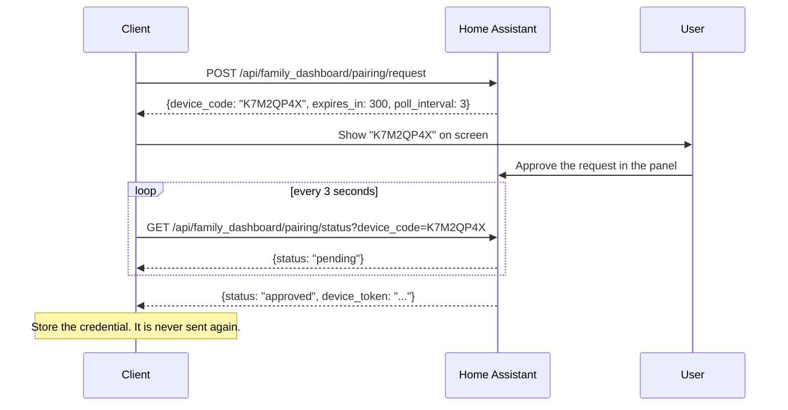

# Family Dashboard client contract

This is the contract every client is built against. The machine readable
version is [`openapi.yaml`](openapi.yaml); this file explains the parts that
a schema cannot.

- **Contract version:** 2
- **Base URL:** `http://homeassistant.local:8123`
- **Authentication:** `Authorization: Bearer <device_token>`

## Contents

1. [Pairing](#pairing)
2. [Reading the dashboard](#reading-the-dashboard)
3. [Controlling the dashboard](#controlling-the-dashboard)
4. [Live updates](#live-updates)
5. [Errors](#errors)
6. [Network policy](#network-policy)
7. [Client checklist](#client-checklist)

## Pairing

Every client gets its own credential. A credential is a 64 character uppercase
hex string. It never grants access to anything except this dashboard, and it
can be revoked on its own from the Home Assistant panel.

### Device-initiated (use this)

The only flow that works on a device without a keyboard, such as Apple TV.



The device code is eight characters from `ABCDEFGHJKLMNPQRSTUVWXYZ23456789`.
The alphabet leaves out `0`/`O` and `1`/`I` so a code can be read aloud from a
TV screen and typed on a phone without confusion.

The request expires after five minutes. The credential is handed over exactly
once: if the client loses the response it starts a new request.

Approval always happens in Home Assistant. A client never approves anything,
so a paired device holds no administrative access.

### Code entry (legacy)

For clients with a keyboard. The short pairing code is shown in Home
Assistant, on `sensor.roku_dashboard_config` and in the pairing settings.

```http
POST /api/family_dashboard/pairing/code
{"code": "A1B2C3D4", "device_name": "Living Room TV", "platform": "tvos"}
```

```json
{"device_token": "5F3A...", "device_id": "9c1f..."}
```

The short code is rotated as soon as it has been used.

## Reading the dashboard

```http
GET /api/family_dashboard/device
Authorization: Bearer 5F3A...
```

```json
{
  "ok": true,
  "schema_version": 2,
  "server_time": "2026-10-21T19:38:37+00:00",
  "dashboard_id": "01JB2X3Y4Z",
  "access_mode": "lan",
  "title": "Family Dashboard",
  "theme": { "accent": "#E18A45", "body_text": "#FFF7EA", "...": "..." },
  "capabilities": {
    "actions": ["meal_week", "light_toggle", "..."],
    "stream": true,
    "background": true,
    "theme": true,
    "weekly_meals": true,
    "schedule": true
  },
  "states": {
    "sensor.inside": {"state": "21.5", "attributes": {"current_temperature": 21.5}}
  },
  "resolved_entities": {"inside": "sensor.inside", "outside": "weather.home"},
  "meal_plan": "Tacos",
  "weekly_meal_plan": [{"day": "Monday", "meal": "Pasta", "is_today": false}],
  "calendar_events": [{"title": "Soccer", "start": "2026-10-21T17:00:00+00:00", "...": "..."}],
  "today_events": [],
  "month_calendar": {"title": "October 2026", "event_days": [12, 21, 31]},
  "calendar_schedule": {"title": "October 21", "days": []},
  "background": "fall",
  "has_uploaded_background": false,
  "layout": "home",
  "weather": {"enabled": true, "available": true, "forecast": []},
  "tabs": {"calendar": true, "weather": true, "lights": true, "scenes": true, "climate": true},
  "lights": [{"entity_id": "light.kitchen", "name": "Kitchen", "state": "on"}],
  "scenes": [],
  "climates": []
}
```

Notes for a client:

- **Colours are always `#RRGGBB` strings.** The panel stores them as RGB lists,
  the payload sends them ready to use.
- **`states` only contains the entities the dashboard was configured with.**
  A client never has to filter.
- **`calendar_events` holds the next few events, `today_events` holds all of
  them.** A "show everything today" view uses `today_events`.
- **`tabs` says which tabs to show.** The Home tab is always available.
- **`schema_version` goes up when the shape changes.** A client should ignore
  fields it does not know and keep working when a field it does know is
  missing.

## Controlling the dashboard

```http
POST /api/family_dashboard/device/action
Authorization: Bearer 5F3A...
Content-Type: application/json

{"action": "light_toggle", "entity_id": "light.kitchen"}
```

| Action | Value | Notes |
|---|---|---|
| `meal_week` | seven meal strings, Monday first | Replaces the whole week |
| `light_toggle` | – | |
| `light_brightness` | `1` to `100` | A percentage |
| `scene_activate` | – | Scenes and scripts |
| `climate_temperature` | a temperature | |
| `climate_mode` | a mode | Must be one of the entity's `hvac_modes` |

Every action is allowlisted. An entity that was not selected in the
integration options is refused with `not_allowed`, so a client cannot reach
anything the dashboard does not show.

## Live updates

```http
GET /api/family_dashboard/stream
Authorization: Bearer 5F3A...
Accept: text/event-stream
```

The stream is server-sent events.

| Event | Data | When |
|---|---|---|
| `dashboard` | the whole payload | Once, when the stream opens |
| `state` | `{"entity_id", "state", "attributes"}` | A displayed entity changed |
| `refresh` | `{"reason"}` | The configuration changed |

A comment line (`: keepalive`) is sent every 25 seconds so the connection
stays open.

This endpoint exists so a client never needs a Home Assistant long-lived
access token. A long-lived token grants access to the whole Home Assistant
instance, which is far more than a television needs.

The stream only pushes entities the dashboard displays. Weather forecasts and
calendar events change on their own schedule, so a client should still
re-read the dashboard every few minutes.

## Errors

Every error is a JSON object with an `error` field.

| Error | Meaning |
|---|---|
| `invalid_token` | The credential is missing or unknown |
| `invalid_pairing_code` | The short pairing code is wrong |
| `unknown_device_code` | The device code is wrong or expired |
| `network_access_denied` | The network policy blocks this client |
| `invalid_json` | The request body could not be read |
| `invalid_meal_plan` | `meal_week` did not carry seven days |
| `invalid_mode` | The climate mode is not supported by the entity |
| `not_allowed` | The entity is not part of the dashboard |
| `service_failed` | Home Assistant refused the command |
| `no_background` | No background image has been uploaded |

## Network policy

The integration answers on the local network and over Tailscale. The
administrator can also allow an external HTTPS address, which is what makes
the dashboard work outside the house.

When the address is not allowed the client gets `network_access_denied`. A
client should say so plainly rather than showing a connection error, because
the fix is in Home Assistant, not on the device.

## Client checklist

- [ ] Store the credential in the keychain, never in user defaults.
- [ ] Send the credential as an `Authorization: Bearer` header.
- [ ] Handle `network_access_denied` with a message that points at Home
      Assistant.
- [ ] Read `tabs` before building the navigation.
- [ ] Use `theme` colours instead of hard coded ones.
- [ ] Reconnect the stream when it drops, with a backoff.
- [ ] Treat `schema_version` as a version to check, not to enforce.
